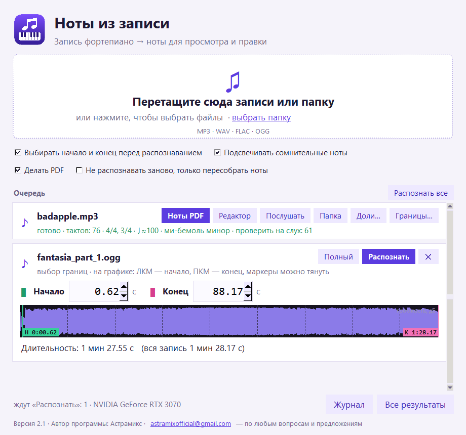
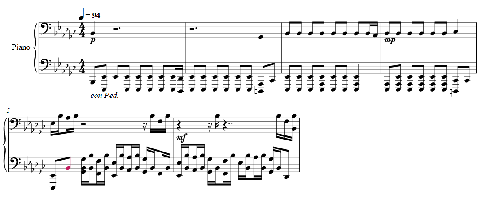
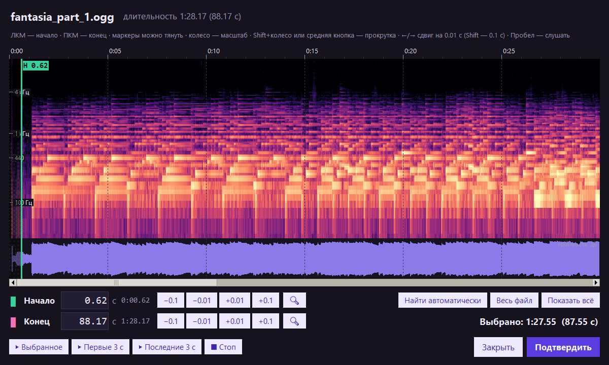
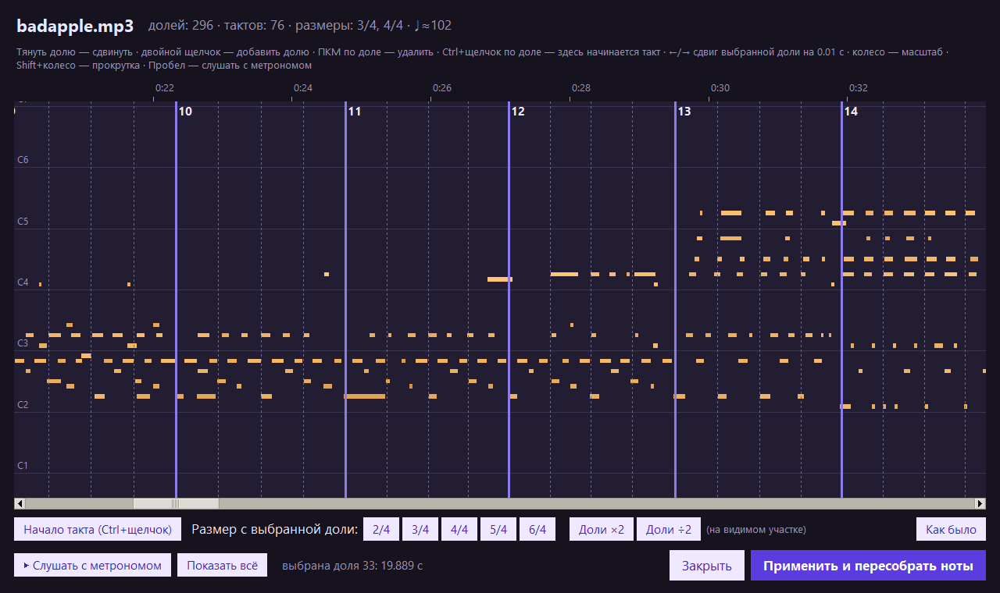

# Ноты из записи

**Запись фортепиано → ноты для просмотра и правки.** Программа для Windows: перетащите
в окно MP3 или папку с записями, получите PDF для чтения и MusicXML для правки
в MuseScore, Dorico или Sibelius.

*Piano recording (MP3/WAV/FLAC/OGG) → editable two-staff score (MusicXML, PDF, MIDI). Windows, Russian UI.*

Создавалась для живых записей быстрых, технически сложных импровизаций, вплоть до
рахманиновской фактуры: с рубато, педалью, перекрещиванием рук и пассажами
по 5–7 нот на долю.





## Возможности

- **Перетаскивание** файлов и папок в окно или на ярлык программы; очередь из любого числа записей.
- **Начало и конец музыки** прямо в очереди: график громкости с маркерами, поля со стрелками
  (шаг 0.01 с) и длительность выбранного куска. Окно «Полный» показывает спектр, позволяет
  приблизить и прослушать кусок.
- **Две руки с перекрещиваниями.** Ноты делятся между руками с учётом растяжки, скорости
  скачков, непрерывности линии и ровности ритма каждой руки.
- **Голоса внутри руки.** Мелодия, которую держит палец над перебором, пишется отдельным
  голосом со штилями вверх, удерживаемый бас — со штилями вниз.
- **Ритм с рубато.** Темп следует за исполнением; доли подстраиваются под сыгранные ноты.
  Поддерживаются триоли, квинтоли, секстоли, септоли и форшлаги.
- **Размер может меняться** по ходу пьесы (2/4, 3/4, 4/4).
- **Редактор долей и тактов** для мест, где ритм понят неверно: сетка долей поверх сыгранных
  нот, прослушивание с метрономом, пересборка нот за секунды.
- Тональность и правописание знаков, смена ключей, педаль (`con Ped.` или `Ped. *`),
  динамика, обозначения темпа. Сомнительные места подсвечены малиновым цветом.

| Окно «Полный»: спектр и точные границы | Редактор долей и тактов |
|---|---|
|  |  |

## Установка

Нужен Windows 10 или 11 и около 5 ГБ на диске (с видеокартой NVIDIA) или 1.5 ГБ (без неё).

1. Скачайте проект: зелёная кнопка **Code → Download ZIP** (или [последний релиз](../../releases/latest))
   и распакуйте в любую папку.
2. Запустите **`setup.bat`**. Он сам:
   - найдёт Python 3.12 или скачает и установит его (только для текущего пользователя);
   - поставит PyTorch: для видеокарты NVIDIA, если она есть, иначе для процессора;
   - поставит библиотеки, скачает модель долей, соберёт программу и ярлык на рабочем столе.
3. Откройте **«Ноты из записи»** с рабочего стола.

Нужен интернет; при обрывах загрузки повторяются, а повторный запуск `setup.bat` продолжит с того
же места. Подробности установки пишутся в `setup_log.txt`.

Скорость: трёхминутная запись — около 15 секунд на видеокарте NVIDIA и несколько минут на процессоре.

## Как пользоваться

1. Перетащите записи или папку в окно (или на ярлык).
2. У каждой записи появится график громкости. Маркеры начала и конца стоят там, где программа
   нашла звук; поправьте их мышью или в полях над графиком. Нажмите **«Распознать»**
   (или **«Распознать все»** над очередью).
3. Когда запись готова, у неё появляются кнопки:
   - **Ноты PDF** — посмотреть и распечатать;
   - **Редактор** — открыть MusicXML (нужен [MuseScore 4](https://musescore.org), бесплатно);
   - **Послушать** — что распознано, до выравнивания по тактам;
   - **Папка**, **Доли…** (исправить ритм), **Границы…** (распознать заново с другими границами).

Если выбирать границы не нужно (например, для целой папки старых записей), снимите галочку
«Выбирать начало и конец перед распознаванием» — записи пойдут целиком.

### Окно «Полный»

| | |
|---|---|
| левая / правая кнопка мыши | начало / конец |
| колесо, Shift+колесо | масштаб, прокрутка |
| стрелки ← →, с Shift | сдвиг маркера на 0.01 с, на 0.1 с |
| Пробел | прослушать выбранное |

Время можно ввести числом: `12.34` или `1:05.37`. «Подтвердить» (Enter) переносит границы в главное
окно, «Закрыть» (Esc) — без изменений.

### Доли и такты

Ритм в нотах строится по долям, которые программа слышит в записи. Если ритм «поплыл» или такты
начинаются не там, откройте **«Доли…»**:

| | |
|---|---|
| тянуть линию | сдвинуть долю |
| двойной щелчок | добавить долю |
| правая кнопка по доле | удалить долю |
| Ctrl+щелчок по доле | здесь начинается такт |
| стрелки ← → (с Shift) | сдвиг выбранной доли на 0.01 с (0.001 с) |
| Пробел | слушать запись с метрономом по этим долям |

«Размер 2/4…6/4» ставит такты через N долей начиная с выбранной; «Доли ×2» / «Доли ÷2» помогают,
если на участке темп понят вдвое медленнее или быстрее. «Применить и пересобрать ноты» пересобирает
ноты за секунды, без повторного распознавания.

### Что получается (папка `out\<имя записи>\`)

| файл | что это |
|---|---|
| `score.pdf` | ноты для просмотра и печати |
| `score.musicxml` | ноты для правки в MuseScore 4, Dorico, Sibelius |
| `performance.mid` | точная запись того, что сыграно (без выравнивания по тактам) |
| `score.mid` | как звучат ноты после выравнивания |
| `beats.json`, `beats.npz` | доли и такты; служебные данные для быстрой пересборки |

### Как проверять результат

1. Послушайте `performance.mid`: если ноты те, распознавание верно.
2. Послушайте `score.mid`: если ритм «поплыл», поправьте доли в «Доли…».
3. Правьте `score.musicxml` в MuseScore, начиная с подсвеченных малиновым мест.

## Точность

Качество проверяется на стенде (`bench\bench.py`): настоящие фортепианные ноты (Шопен, Моцарт,
Джоплин, Клара Шуман, Шёнберг) и синтетические этюды (перекрещивание рук, романтическая фактура,
пассажи по 5–7 нот) «исполняются» моделью пианиста — с рубато, неровными пальцами и неточно
найденными долями — и результат сравнивается с нотами.

| | v2.0 | v2.1 |
|---|---|---|
| нота в правильной руке | 84% | **89%** |
| …перекрещивания рук | 79% | **95%** |
| нота на правильном месте в такте | 86% | **97%** |
| …свободная игра (рубато ±25%) | 78% | **91%** |
| нота записана полностью верно (рука, место, длительность) | 55% | **77%** |

Слабое место — фактура, где руки переплетаются нота через ноту (около 55% по рукам).

## Как это устроено

1. [Transkun](https://github.com/Yujia-Yan/Transkun) — нейросеть: звук → сыгранные ноты, силы нажатия, педаль.
2. [Beat This!](https://github.com/CPJKU/beat_this) — нейросеть: вероятности долей и сильных долей.
3. Поиск темпа (динамическое программирование), который следует за рубато и не прыгает в двойной темп;
   такты и смены размера — алгоритмом Витерби по сильным долям.
4. Деление на руки — лучевой поиск; веса признаков обучены на стенде (`bench\train_hands.py`).
5. Выравнивание по долям — отдельно для каждой руки и доли, с подстройкой долей под ноты;
   параметры подобраны на стенде (`bench\tune_rhythm.py`).
6. Голоса, длительности, тональность, ключи, педаль, динамика — [music21](https://web.mit.edu/music21/);
   PDF — [Verovio](https://www.verovio.org) и встроенный в Windows браузер.

## Командная строка

```
.venv\Scripts\python transcribe.py запись.mp3 [ещё.mp3 ...]       распознать
.venv\Scripts\python transcribe.py запись.mp3 --start 30 --duration 20   фрагмент
.venv\Scripts\python transcribe.py запись.mp3 --rescore           пересобрать ноты без распознавания
.venv\Scripts\python bench\bench.py [--hard]                     проверка качества
```

Без аргументов `transcribe.py` (или `transcribe.bat`) обрабатывает все записи в папке программы.

## Если что-то не так

- Программа не запускается или пропал ярлык — запустите `setup.bat` ещё раз.
- Ошибка при распознавании — кнопка «Журнал» в окне или файл `gui_log.txt`.
- Старая версия 1.0 (только командная строка) — ветка [`v1`](../../tree/v1).

## Автор

**Астрамикс** — astramixofficial@gmail.com, по любым вопросам и предложениям.
